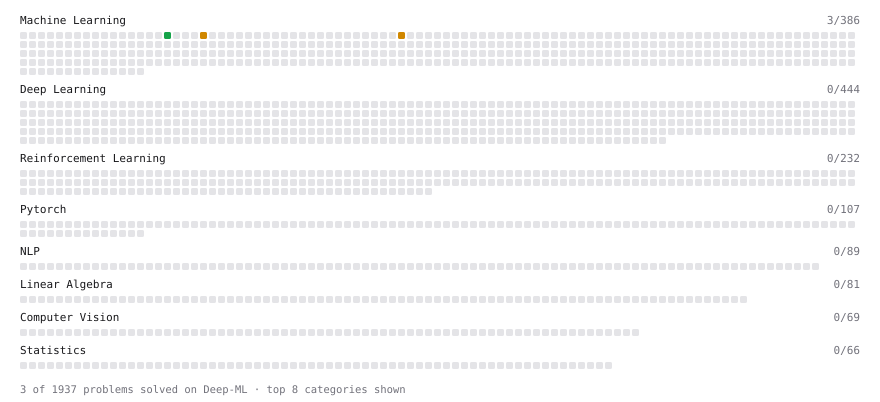

# Deep-ML

My machine learning practice from [Deep-ML](https://www.deep-ml.com). Every solution here was written by hand.

**2** solved · 0 problems · 0 labs · 2 math

[**Browse the interactive portfolio**](https://shiveshupadhyay.github.io/deep-ml/) to replay this filling in over time.

## Math

| | Difficulty | Solved | |
| --- | --- | --- | --- |
| [Bias–Variance Decomposition](https://www.deep-ml.com/math-problems/39) | medium | 2026-11-09 | [solution](math/0039-bias-variance-decomposition) |
| [Regularization and Generalization](https://www.deep-ml.com/math-problems/31) | medium | 2026-11-09 | [solution](math/0031-regularization-and-generalization) |

---

_This file is regenerated by Deep-ML on every push._
